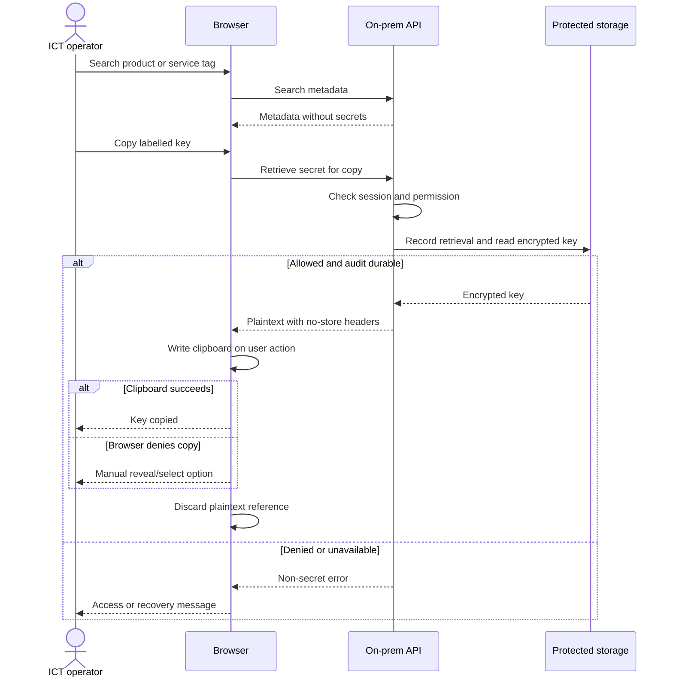
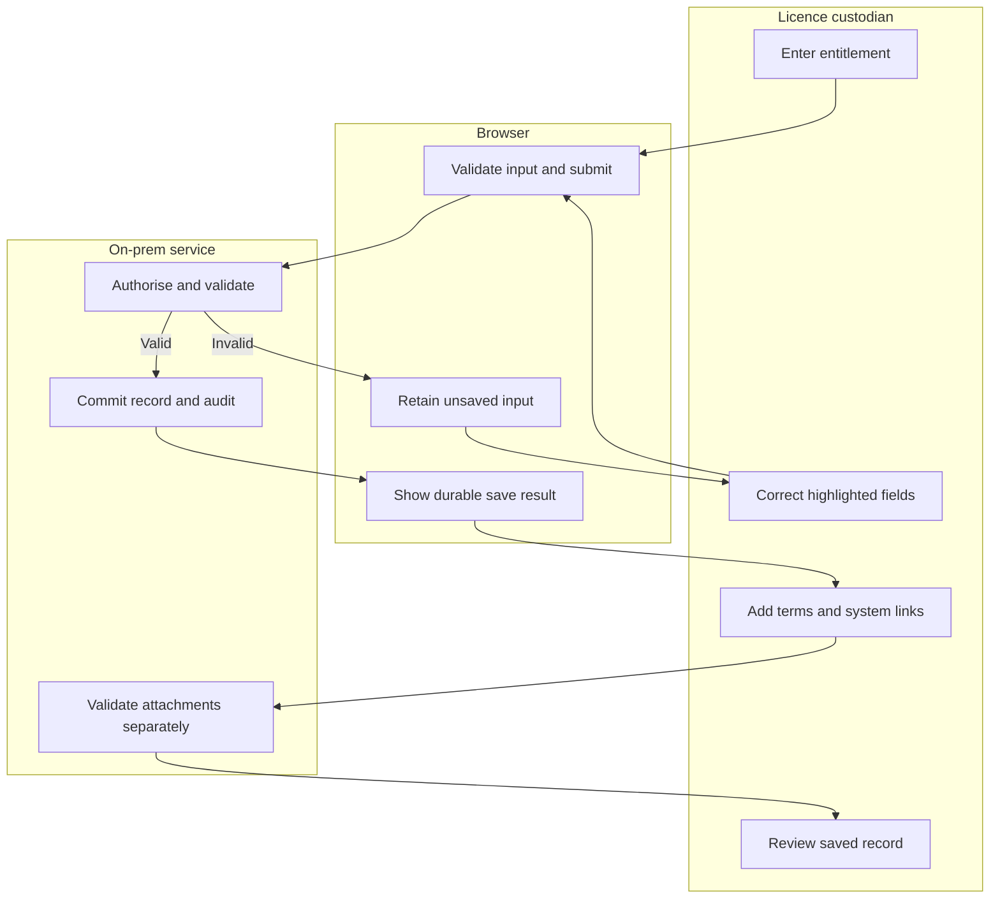
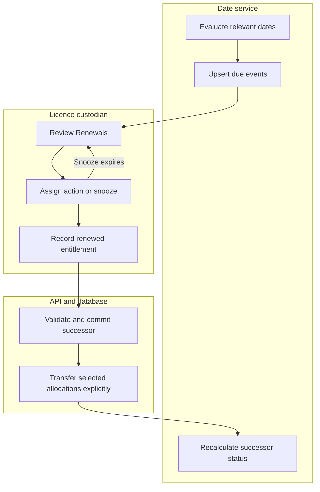
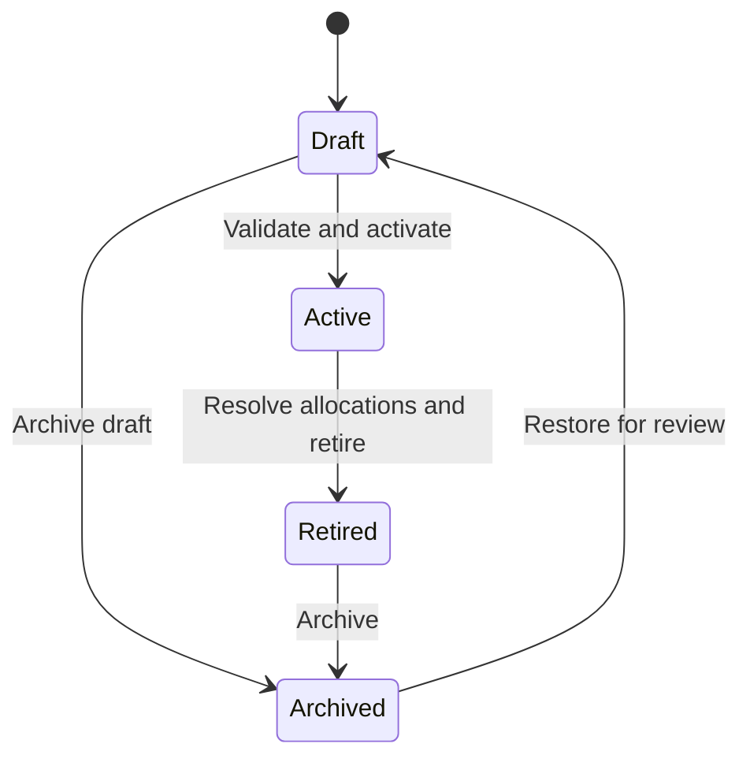

# User workflows

Proposed workflows v0.1. Public demo simulates server responses using fictional fixtures; on-prem implementation must enforce authority on the server.

## Lookup and copy sequence

The server can prove secret retrieval; it cannot prove that OS clipboard contents were retained or cleared. A client copy outcome is optional supplementary evidence, not an authoritative audit of the clipboard.

## Swim lanes: capture and review

Core entitlement save does not depend on later attachment success. A rejected attachment leaves the saved record intact and shows a retry path.

## Swim lanes: expiry and renewal

## Entitlement lifecycle state machine

Expiry and support status are derived date indicators, not lifecycle transitions. An active record may show expired rights; a perpetual record may show expired support. Renewal creates a successor and preserves its predecessor.
